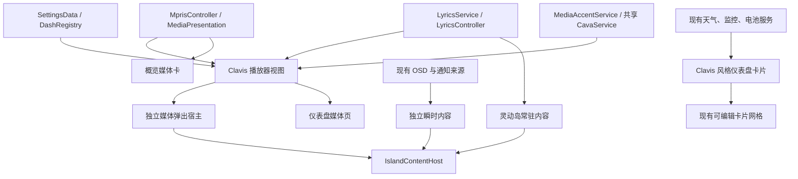

# Clavis 播放器、灵动岛与仪表盘整合方案

日期：2026-10-31。状态：已在 `feat/clavis-integration` 实现并完成有限场景验收；结果、使用方式和未覆盖边界见 [交付与验收记录](clavis-integration-acceptance.md)。下文保留实施前调研和设计依据；调研阶段没有修改实现、运行测试或调整桌面设置。

本方案纳入用户补充：**播放器以完整移植 Clavis 的播放界面、交互及全部媒体外观设置为目标**。只做一个类似截图的主题皮肤，不满足这一目标。

## 1. 调研基线与证据范围

| 对象 | 已核对的基线 |
| --- | --- |
| DMS 工作目录 | `/home/zydr/AgentWorkspace/dms-custom` |
| DMS 分支与提交 | `feat/statindet-capsule`，`0e3edd55f`；调研开始时工作区干净，与本地 origin 跟踪引用一致 |
| 参考源码 | `/home/zydr/AgentWorkspace/references/statindet-quickshell`，origin 为 `StatIndet/quickshell` |
| Clavis 固定提交 | `c3ee54f147d5e85db072573857a83ca949a317a0`，提交日期 2026-10-07；本方案针对这个快照，不宣称是远端最新版本 |
| 本机 Clavis 入口 | `~/.config/quickshell/clavis` 指向 `/home/zydr/AgentWorkspace/quickshell`，其 HEAD 与参考快照相同 |
| 当前运行的 DMS | 进程参数为 `qs -p /home/zydr/AgentWorkspace/dms-custom/quickshell` |
| 实际截图目录 | `/home/zydr/AgentWorkspace/references` |
| 当前显示器 | HDMI-A-1，物理 2560×1440，逻辑 2048×1152，缩放 1.25；内屏当前未启用 |

查看了四张 Clavis 截图：`clavis-player.png`、`clavis-island-osd.png`、`clavis-widget.png`、`clavis-weather.png`。另有 iNiR 截图，本次不以它替换 Clavis 的设计方向。

调研分为六轮：截图视觉拆解 → DMS 当前入口和尺寸链 → Clavis 播放器与设置逐项对照 → 灵动岛状态与歌词 → 小组件数据及依赖 → 常驻开销、兼容和验收设计。证据主要来自上述固定源码、本机设置、运行参数与只读显示器信息；没有打开面板复现问题，也没有进行视觉验收、性能测量或测试。下文的尺寸和性能约束是设计目标。

## 2. 已确认的关键发现

### 2.1 媒体弹出层存在结构性的尺寸耦合

当前调用链是：

```text
DIsland / MediaExpanded
  → DashTabFace
    → MediaPlayerTab
      → MaterialIiChrome / MaterialChrome / BentoChrome
```

`MediaExpanded.qml` 直接复用 `DashTabFace`；后者通过 `DashMetrics.panelHeightFor()` 将媒体内容放进仪表盘行高系统。`IslandController.mediaExpandedTarget` 同样调用 `dashboardTargetFor("media")`。

结果是媒体弹出层受到 `minimumPopoutWidth = 700`、`minimumTabRows = 4`、`gridRowUnit = 96` 的约束。即使媒体页声明了 `sizeToContent`，它也只将默认行数从五行降到四行，不能真正按短横向播放器收缩。当前 Material II 自己又按较矮的横向比例计算内容高度，两套尺寸规则可能产生明显空白及比例不协调。

这能从源码解释用户报告的布局问题，但不能替代本机打开面板后的最终复现。**先修媒体宿主的尺寸契约，再接入 Clavis 播放器。只调封面大小或一个缩放系数不能解决这一耦合。**

### 2.2 Clavis 播放器有明确、完整的可移植边界

主体在 `Modules/Keystone/MediaContent/MediaContent.qml`，配合 `MediaCover.qml`、`CaelestiaCover.qml`、`MediaBackdrop.qml` 及通用控制组件。

核心外观设置为三组，共 **2×3×2 = 12 种组合**：

| Clavis 设置 | 全部选项 | 行为 |
| --- | --- | --- |
| `media.progressStyle` | `wave` / `material` | 正弦波进度条 / Material 波浪进度条，两者都支持拖动跳转 |
| `media.coverStyle` | `rounded` / `caelestia` / `background` | 圆角封面 / 旋转九瓣封面加环形频谱 / 左侧封面渐隐背景 |
| `media.colorStyle` | `theme` / `cover` | 跟随主题 / 从封面取色并提供对应的前景与轨道颜色 |

源实现的内容基准为：圆角封面 `540×210`；Caelestia 或背景封面 `640×240`。这些是内容尺寸，外围壳体、边距和把手需要另算；不能将截图像素直接作为 QML 逻辑尺寸。

界面还包含标题、歌手、播放/暂停形变、上一首/下一首、随机播放、三态循环，以及右上角可展开的播放器选择徽标。徽标只有一个播放器时不会展开；截图中的播放器名称不能直接理解成源码已经实现了“打开播放器应用”的动作。DMS 若增加这个动作，应单独判断 MPRIS 的可用能力。

本机 Clavis 保存的媒体设置恰好是：`material + caelestia + theme`。它可以成为参考预设，而不是覆盖 DMS 用户现有全部设置的理由。

### 2.3 截图的细条是通知倒计时

`clavis-island-osd.png` 显示的是 “Screenshot captured” 通知。源码 `NotificationContent.qml` 的 `expiryProgress` 由 `popupStartedAt` / `popupExpiresAt` 驱动，底部细条表示通知剩余展示时间。

因此要实现两套具有不同含义的进度：

- 音量、亮度等 OSD：真实数值比例；静音及超 100% 音量按 DMS 的实际范围处理。
- 通知：剩余展示时间；持久通知不伪造倒计时，悬停、去重更新与实际消失时间保持一致。

### 2.4 DMS 已有可复用能力，也有不能假装补齐的数据缺口

可复用的能力包括 `MprisController`、`MediaPresentation`、`LyricsService` / `LyricsController`、`MediaAccentService`、`WeatherService`、`DgopService`、`BatteryService`，以及 `DashRegistry` 和现有可编辑网格。

现有仪表盘媒体卡 `MediaOverviewCard.qml` 与完整媒体页是两套呈现，新增播放器样式不会自动改变概览卡。两处都要纳入实施范围。

天气已有当前状况、体感、高低温、逐小时与逐日预报、湿度、风速、气压、能见度、紫外线和日月相关字段；截图里的 AQI、昨天实况及气候标准线不在当前 `weather` 对象中。网络和磁盘卡目前消费汇总速率，截图中按网卡、磁盘设备选择的交互需要另外核对服务接口，不能只画下拉菜单。现有 GPU 路径也不能直接视作已经提供截图所需的全部利用率指标。

### 2.5 完整频谱不能用六段数据冒充

Clavis 的共享 `AudioSpectrum` 取得 45 段数据，Caelestia 封面把它汇聚成 36 条随封面轮廓变化的频谱柱。DMS 当前 `CavaService` 固定为六段、25 fps；Material II 背景的 32 条柱也是从六段插值而来。

完整播放器应提供真实的较高分辨率输入，并保留旧消费者的六段接口。仅增加 36 个绘制元素不会得到 Clavis 的频谱细节。Clavis 原生采样与 DMS 外部 cava 的增益、平滑及频段配置不同，接入后还需用同一音源校准，不能预先承诺动态效果逐帧一致。

另发现 DMS `AudioVisualization.qml` 以 `live` 持有 Cava 引用，没有把 `audioVisualizerEnabled` 纳入订阅条件，而显示状态用了该开关。它存在关闭可视化后仍申请采样的风险，应在这次接入时修正。本轮只读检查时未发现运行中的 cava 进程，不据此宣称当前已经产生额外负载。

### 2.6 源码授权必须随移植一起处理

DMS 当前根许可证为 MIT；Clavis 根许可证为 GPL-3.0，`CaelestiaCover.qml` 明确记录了来自 Caelestia 的 GPL 来源，Cookie Clock 也有 end-4 的 GPL 来源说明。这是直接复制源码前必须明确的工程边界。

推荐先按**完整 UI 移植与 DMS 适配**设计技术方案，并逐文件记录来源、修改和许可证。若采用直接复制/改写，实施前需要确定这些文件和组合发行的许可安排，保留相应声明；仅增加一个 NOTICE 文件不能视为已经解决组合发行问题，也不能继续笼统声称新增来源代码都是 MIT。若要求本项目继续完全按原 MIT 方式分发，则采用基于截图、功能清单和 DMS 现有控件的独立实现路径；界面和设置的完整目标不因此降级。

实施选择：用 DMS 现有服务、控件和形状数据独立实现完整的界面及设置行为，不复制 GPL 来源的 QML/native 实现，沿用仓库现有 MIT 许可。Clavis 的固定源码和截图作为视觉、功能与设置对照资料。

## 3. 整体设计

采用 **完整 Clavis 播放器视图 + DMS 数据适配 + 灵动岛独立布局策略 + 原有仪表盘网格**。



媒体视图消费统一的 player/呈现接口，所有宿主共享设置、活动播放器、歌词时轴和颜色服务。保留 DMS 对短暂缺失元数据、播放器切换、音量回写及拖动跳转的处理；不把 Clavis 的常驻 `MediaManager`、歌词 native module、配置系统整套带入 DMS。

界面落在目前实际使用的 `DIsland`、`DDash` 和 `DBar` 路径。旧 `DankDash` / `DankBar` 同名文件不作为默认改动目标。

## 4. 完整播放器的实施设计

### 4.1 界面与交互范围

完整移植以下内容：

1. 横向封面与信息布局；三种封面各自的占位、留白和外框关系。
2. 标题、歌手、缺失封面与无媒体状态；播放器徽标展开及活动播放器置顶。
3. 两种波浪进度条，含已播/未播段间隙、端点、拖动预览与释放跳转。
4. 播放/暂停形变、随机播放、上一首、下一首、无循环/列表循环/单曲循环。
5. 主题配色和封面配色，包括控制按钮、轨道、背景的对应前景颜色。
6. Caelestia 九瓣轮廓旋转和随轮廓排列的 36 条真实频谱柱。
7. 左侧渐隐背景封面模式；它与 DMS 原来的整卡模糊背景不是同一个效果。
8. 切换模式时的尺寸变化和动画；暂停、隐藏、减少动态效果时停止连续装饰动画。

DMS 原有的歌词、音量、输出设备和键盘操作继续可用，通过次级操作或展开区域承载，默认主视图保持参考图的信息密度。按钮须依据 `canControl`、`canSeek`、随机/循环支持等实际能力禁用；不能因为存在播放器就一律启用。

“打开应用”作为可用时的附加动作，与“切换播放器”分开；不虚构播放队列、收藏或歌词逐字时间。

### 4.2 设置映射与同步

| 用户选项 | Clavis 值 | 建议的 DMS 存储 |
| --- | --- | --- |
| 播放器样式 | 完整 Clavis 视图 | `dashOptions.media.playerStyle = "clavis"` |
| 进度条 | `wave` / `material` | 新增 `clavisProgressStyle` |
| 封面 | `rounded` / `caelestia` / `background` | 新增 `clavisCoverStyle` |
| 配色 | `theme` / `cover` | 复用 `albumArtAccent = false / true`，设置界面展示等价语义 |
| 歌词、平滑歌词、标题字体、设备名称 | DMS 已有能力 | 复用现有键，所有入口写同一份配置 |

不把 Clavis 的三种封面硬塞进原 `artStyle` 的五种形状；原形状不包含完整背景布局和环形频谱语义。Clavis 的波浪类型也不等于原来的 `waveProgress` 开关。原有样式和相关设置保留各自含义。

设置入口覆盖“仪表盘 → 媒体”的外观选项、媒体页自身的选项以及媒体设置中的导航。一个入口调整后，其余入口和灵动岛立即读取相同值，不建立第二份独立配置。

提供一个明确应用的 **Clavis 参考预设**：`clavis + material + caelestia + theme`。可增加按需读取本机 `~/.config/clavis/config.json` 的导入动作，先展示三项映射再应用；不监听 Clavis 文件、不进行双向写回、不迁移壁纸/栏位/系统设置。导入器识别旧 `spectrum → caelestia` 别名并过滤非法值。

当前 DMS 使用 `material-ii`，`albumArtAccent=false`，`audioVisualizerEnabled=false`。安装代码不会静默重写这些选择；用户应用参考预设时，应清楚呈现频谱开关的结果。全局禁用频谱时，封面保留造型并静止，不偷偷启动分析器。

### 4.3 弹出层尺寸契约

增加明确的“媒体弹出呈现”路径，允许 `MediaPlayerTab` / 所选视图上报适合弹出的内容尺寸；`MediaExpanded` 和 `IslandController` 消费这一尺寸，不再通过仪表盘最少四行兜底。其他仪表盘页面继续采用网格规则。

- Clavis 以源码 `540×210` / `640×240` 内容尺寸为起点，外加 Theme 边距和必要的壳体。
- 屏幕逻辑尺寸、可用区域及字体缩放参与计算；超宽标题省略，不挤压播放按钮。
- 当空间不足时按断点重排、折叠次级功能，极小空间才使用单列；不将整个交互区简单缩成不可点击。
- 独立弹出层不再显示仪表盘的网格拉伸把手或预留四行编辑空间。完整媒体页仍可使用页面设置。
- 保留现有样式时，根据各自最小内容需求决定尺寸；不能把 Bento 等布局强行压入 Clavis 的横向高度。
- 检查 `IslandContentHost` 的媒体特判、背景与剪裁。当前有针对 Material II 的分支，增加 Clavis 时应使用明确的呈现能力，避免继续堆叠样式名称判断。

### 4.4 频谱和图形依赖

优先扩展现有共享 `CavaService`：增加较高分辨率、归一化的频谱出口，完整环形视图取得 45 段并汇聚成 36 柱；旧 `values` 仍提供六段以及原有量级约定。所有视图复用同一个分析进程。

高分辨率采样仅在有可见、正在播放且允许可视化的消费者时需要。实施时比较“按消费者切换 6/45 段”与“活动期统一 45 段”的成本和切换闪断：前者优先保持旧场景采样成本，后者必须以有限测量证明额外成本可接受。不得为了环形视图启动第二个分析器，也不得用随机数或六段重复值作为完整移植的验收结果。

九瓣轮廓可使用现有 DCommon 的 `cookie9` 数据和极坐标轮廓辅助函数。新展示组件使用已有 Qt Quick / DCommon 图形能力，避免引入 `Clavis.Cava`、`Clavis.Lyrics` 或整套 M3Shapes 原生构建链。波浪进度条可以适配现有组件或移植相应绘制，但两种样式的差别必须真实保留。

## 5. 灵动岛：常驻信息与瞬时反馈并存

### 5.1 紧凑态

建议提供以下构图，沿用已有共享 `ClockContent.qml` 的数字风格和用户设置：

```text
╭──────────────────────────────────────────────────────────────╮
│ 时间  │ 封面  当前歌词 / 曲目信息              │ 音量图标 数值 │
│       │ 可选第二行曲名或歌手                  │              │
│                                      ━━━━━━━━ OSD 数值轨道   │
╰──────────────────────────────────────────────────────────────╯
```

这张结构图表达槽位关系，不锁死全部状态都占两行。普通播放时显示时间、封面和歌词；歌词未准备好、无同步歌词或无歌词时自然回退到曲名/歌手。可选择曲名、歌词或曲名加歌词两行；暂停时保持稳定内容，停止时回主页。

紧凑态的宽度预算建议按屏幕可用空间在约 360–560 逻辑像素内自适应，最终由 Theme 指标与设置上限决定。秒和日期优先折叠，其次是装饰频谱和次要歌手信息；保留基本时间和可辨认的主要内容。长歌词按现有分页/高亮能力处理，不让整座岛随每行歌词无限变宽。

竖向栏、悬浮球及极窄空间不能同时放下相同信息量：使用图标/简短状态并通过悬停或展开查看全文。水平灵动岛是首要验收场景，其他布局必须有可用回退。

### 5.2 OSD 与通知的仲裁

当前 `activeActivity` 在媒体、主页、通知和系统 OSD 之间切换；展开状态下 `requestSystemActivity()` 还会拒绝不同活动。这种单一替换方式不适合“时间、歌词、OSD 同时显示”。

改为区分 **常驻内容**、**用户展开内容** 和 **瞬时内容**。这只是小范围的状态职责划分，不新增可任意注册活动的通用框架：

| 事件 | 预期行为 |
| --- | --- |
| 音乐开始/曲目切换 | 按已有自动切换设置更新常驻媒体内容，沿用元数据稳定期 |
| 调整音量/亮度 | 更新侧槽或细轨道；时间与歌词仍在，超时后只撤掉 OSD |
| 媒体面板已展开时调音量 | 在当前面板内给出小型反馈，保持展开、键盘焦点和拖动状态 |
| 普通通知到来 | 紧凑态按现有通知策略展示摘要及倒计时；用户正在操作展开面板时不强制抢走页面 |
| 严重通知 | 沿用现有严重通知策略，并保留可恢复的活动与焦点 |
| 通知到期/关闭 | 恢复到当前有效的常驻内容，不能恢复已经失效的旧曲目 |
| 连续滚轮或快捷键 | 合并为当前瞬时反馈并续期，不积压队列 |

音量/亮度轨道绑定服务实际范围，不能把音量超过 100% 当作非法值。通知倒计时绑定真正负责关闭的期限；当前 DMS 同时有 wrapper timer 与 controller timer，实施时统一呈现依据，避免两个独立计时器漂移。悬停冻结、移开后按现有续期规则重置、去重通知刷新与手动关闭都要同步到细条。

Apple Live Activities 指南可借鉴紧凑、最小和展开呈现、按内容动态调整高度以及圆角内等距留白。桌面上的时间/歌词/OSD 组合是本项目的设计扩展，不声称是 Apple 已提供的原样行为。

### 5.3 展开态的功能与设置

点击媒体区域打开第 4 节的完整播放器；时间区域保留主页入口。歌词可进入 DMS 的完整歌词界面；展开面板提供播放器选择、音量/输出设备、随机/循环及歌词入口。外部点击、Esc、焦点返回和子菜单的点击边界遵循现有弹出层约定。

设置沿用每个 bar/岛实例的存储方式，避免引入另一套全局岛配置：

- 复用 `islandMediaClockVisible`、`islandMediaAutoSwitch`、`islandSystemOsd` 与现有路由键。
- 新增媒体文字模式、合理宽度上限、OSD 替换/附属呈现选择，以及通知倒计时开关。
- 继续使用全局减少动态效果设置；不再创建一个独立、语义重复的动画总开关。
- 新行为通过清楚的预设或选项启用，保留旧用户明确保存的偏好。

## 6. 仪表盘：使用 Clavis 风格卡片，保留 DMS 网格

不另造一个固定布局的 Clavis 侧栏。新外观进入 `DashRegistry`，继续支持添加、排序、拖动、缩放和保存 `dashCards`；首次应用参考布局应预览并保留原布局备份。

| 卡片 | 首批目标 | 数据与尺寸原则 |
| --- | --- | --- |
| Cookie 模拟钟 | 花瓣表盘、粗指针、中央数字、外侧日期气泡 | 新增 `cookie` 样式，保留数字钟和原模拟钟；建议 2×2 起，气泡和指针外缘一同计入布局 |
| 媒体 | 与完整播放器一致的封面、控制和配色语言 | 小尺寸显示核心控制；足够宽大时显示完整控制；点击进入相同的完整播放器 |
| 天气 | 大温度、分层天空/地形底图、清晰的状态和高低温 | 概览卡紧凑呈现；天气页提供完整 Hero、逐日/逐小时卡；复用现有服务 |
| 电池 | 竖向电池容器、液位、充电状态和剩余时间 | 建议 1×2；不在缺少数据时写出虚假的功率或健康值 |
| 内存 | 花瓣/软方形容器与液位 | 建议 1×1；液位值改变时动画，不做常驻水波模拟 |
| CPU | 大色块、温度标签、短趋势图和角落造型 | 建议 2×1；复用现有 CPU 指标和有限历史 |
| 日期 | 双层色块、星期/月与大日期数字 | 独立小卡，与完整日历共用日期来源，不丢失日历能力 |
| 网络、磁盘 I/O | 左侧大标签、右侧深色速率区 | 建议 3×1；首批使用真实汇总值，按设备选择另行补齐数据契约 |

卡片网格单位是逻辑排版，当前列宽与行高并不相等。Cookie 钟必须在格子内使用内切的正方形构图，不能因 2×2 网格就假设像素尺寸正好是正方形；日期气泡需要额外安全区，避免被现有卡片剪裁吞掉。

Cookie 钟的样式设置可对齐 Clavis：花瓣数、持续旋转、小时刻度、中央时间、表盘类型、时/分/秒针类型、日期气泡。首个可交付版本至少具备截图默认造型、显示秒、日期和主题色；完整可选项在同一阶段后续提交补齐，不以固定贴图代替时钟。

Clavis 的任意花瓣数依赖 M3Shapes 的自定义形状工厂。DCommon 已有部分固定轮廓；任意花瓣数需要小型、可测的几何适配，不能把缺失的原生 API 当作已经存在，也不编辑生成的形状数据文件。

天气部分先覆盖截图的视觉主干和已有数据。AQI、昨天实况、气候标准线、天气地图属于另外的数据能力工作；如加入，需要明确来源、缓存、失败状态和请求频率。GPU 利用率、按设备网络/磁盘统计同理，不与单纯的卡片换肤混为一项完成声明。

## 7. 实施阶段与提交边界

以下为实施时的顺序，**不是本轮已经执行的修改**。每步完成对应检查，形成独立提交；进入编码阶段后按用户 Git 约定同步开发分支，保持每一步可回退。

| 阶段 | 具体产物 | 完成条件 |
| --- | --- | --- |
| P0：移植清单与几何基础 | 固定来源/许可路径、12 组合清单、媒体弹出尺寸策略与断点 | 清楚区分媒体弹出层和仪表盘网格；原有样式都有明确最小尺寸 |
| P1：完整播放器 | Clavis 视图、三种封面、两种进度、两种配色、五个播放控制、源切换、设置同步 | 12 种组合全部可选且可保存；核心交互与 DMS 原能力接通 |
| P2：频谱与动态效果 | 共享高分辨率采样、真实 36 柱环形视图、暂停/隐藏/禁用释放 | 单一采样进程；旧六段消费者可用；完成同音源效果和开销检查 |
| P3：灵动岛 | 时间/歌词并存、OSD 附属呈现、通知倒计时、完整媒体弹出 | 调节音量不会挤掉歌词或关闭用户面板；通知细条与真实时限一致 |
| P4：核心仪表盘卡片 | Cookie 钟、媒体卡、天气卡/天气页主视觉 | 现有网格内可编辑；尺寸变化不裁切、不重叠；相关设置完整接入 |
| P5：其他 Clavis 卡片 | 电池、内存、CPU、日期、网络和磁盘 I/O 外观 | 使用真实现有数据，保持采样订阅和历史长度有界 |
| P6：整体验收与文档 | 当前配置预设、兼容检查、视觉证据、有限性能记录与回退说明 | 区分实际通过、源码保证、尚未覆盖的场景；不以 lint 代替视觉验收 |

P1 与 P2 合起来才可称为完整的 Clavis 播放器目标完成。P3、P4 也是本次用户需求的主体，不因播放器完成就提前结束整个整合工作。P5 可在核心三项达到要求后继续，额外数据源扩展需独立界定范围。

建议的组件落点（名称可在编码时按现有结构简化）：

- `quickshell/Modules/DDash/Media/`：Clavis 主视图、封面、进度条、控制栏与播放器徽标；共享现有 player 接口。
- `quickshell/Common/MediaOptions.qml`、`DDash/DashRegistry.qml`：样式列表、选项定义、默认值和统一设置。
- `quickshell/Modules/DIsland/`：媒体宿主、内容尺寸消费与瞬时反馈；纯尺寸/仲裁辅助逻辑放 `Common/` 可直接测试的位置。
- `quickshell/Services/CavaService.qml`：共享高分辨率出口和订阅；`LyricsService`、`MprisController` 原则上复用。
- `quickshell/Modules/DDash/Overview/`、`DDash/Weather/`：卡片样式和天气主视觉。
- `quickshell/Common/Theme.qml`：新增语义化的尺寸、颜色映射和动画指标；视图内不散落参考源码的像素常量。

现有 DCommon 的固定轮廓和控件足够时直接消费，不为本次样式工作顺手改共享子模块。若必须修改公共接口，则单独处理子模块提交及依赖引用。

## 8. 验收与常驻开销约束

### 8.1 行为和兼容

核心验收矩阵：12 种播放器外观；无播放器/单播放器/多播放器；播放/暂停/停止；缺封面、长中英文标题、元数据短暂缺失、未知时长、不可 seek；随机与三态循环；播放器关闭及切换；歌词载入、无歌词、同步歌词和拖动跳转。

布局验收至少覆盖当前 2048×1152 逻辑屏、当前字体缩放 1.15、1.0/1.25/1.5 的代表缩放与较大字体，另检查顶/底/侧栏及悬浮球回退。内屏、多屏热插拔若没有实际运行条件，应明确写作未验收；不能由配置文件推断通过。

灵动岛重点检查：歌词更新期间连续调节音量；展开播放器时调节亮度；通知到来/续期/悬停/关闭；严重通知；OSD 超时；点击不同槽位、Esc 和外部点击；子菜单不被根点击区吞掉。

### 8.2 自动检查的边界

- 纯 JS 的尺寸约束、选项归一化、旧值映射、频谱汇聚和仲裁行为可增加小型直接调用测试，必须能够捕获实际错误。
- 只对允许的 `Common/` / `Services/` 函数和 IPC 行为写相应测试；不加载、切片或伪造 `Modules/`、`Widgets/`、`Modals/` 组件进行 UI 测试。
- 修改 QML 后进行针对性 lint/解析与相关现有测试。没有修改 Go/socket 协议时不宣称验证了新 backend；如因额外数据能力涉及协议，须同时检查 Go 与 QML 消费方。
- 实际视觉检查使用已经运行的桌面，保留原设置并恢复；测试不新启动 compositor、显示服务器或第二套 shell。

### 8.3 24/7 运行约束

| 资源 | 约束 |
| --- | --- |
| 进程 | 不运行 Clavis shell；最多复用一个现有 cava 分析器，不增加常驻轮询进程 |
| 时钟 | 使用可停止的共享/SystemClock；不显示秒时按分钟精度；隐藏时不继续装饰旋转 |
| 歌词 | 共享 `LyricsService` 的时轴、缓存和按需位置引用，不为每座岛复制请求与轮询 |
| OSD/通知 | 事件驱动，倒计时只在实际显示期间推进，隐藏后没有新建的周期性更新 |
| 频谱 | 无可见有效消费者或总开关关闭时不采样；减少动态效果时呈现稳定回退 |
| 卡片 | 只为可见卡片持有天气/监控/电池订阅；趋势使用现有有界历史 |
| 图片与图层 | 按实际尺寸限制解码；隐藏后释放不需要的视图/图层；避免同一封面重复重建无界缓存 |
| 设置 | 复用现有持久化节流；不为 Clavis 配置创建永久文件监听或双向同步 |

有限性能验收应记录同一配置下改动前后空闲、播放且收起、面板展开、暂停、关闭面板后的 CPU/RSS、进程及活动定时器变化；采样窗口约 30–60 秒、重复若干次，并观察多次开合后内存是否持续增长。任何数值都在测量后填写，不预先声称零开销或证明长期无泄漏。

连续动画优先由现有 scene graph/图形能力完成。若直接移植的 Canvas 每帧重绘或路径字符串重建成为瓶颈，可以替换绘制方式，但必须保持两种进度条及轮廓动画的可见行为，不能以优化名义删掉已承诺的完整设置。

### 8.4 项目约定

面向用户文案使用 `I18n.tr()`，复用既有目录术语，不编辑翻译目录。交互和滚动使用 DCommon 的 D* 控件。每项视图和每屏组件的属性变化采用具名、带类型的绑定与就地处理；服务单例及允许的普通信号连接保留 `Connections`。不编辑生成代码，不为了简单适配引入新库。

## 9. 源码与资料定位

以下行号针对调研固定提交，实施后可能变化：

| 证据 | 位置 |
| --- | --- |
| Clavis 三组媒体设置 | `Services/PersonalizationConfig.qml:485`、`Modules/ControlCenter/KeystonePage.qml:310` |
| Clavis 播放器尺寸与控制 | `Modules/Keystone/MediaContent/MediaContent.qml:41` |
| 真实 36 柱与封面轮廓 | `Modules/Keystone/MediaContent/CaelestiaCover.qml`、`Services/AudioSpectrum.qml` |
| Clavis 通知倒计时 | `Modules/Keystone/NotificationContent/NotificationContent.qml:38`、`:201` |
| Clavis 紧凑歌词 | `Modules/Keystone/LyricsContent/LyricsContent.qml`、`HorizontalLyricsLayout.qml` |
| Cookie 钟与其完整选项 | `Modules/SystemCards/SidebarCookieClock.qml`、`Services/UiPreferences.qml:33` |
| 卡片与天气参考 | `Modules/SystemCards/`、`Modules/Sidebars/Dashboard/WeatherView.qml` |
| 授权来源 | Clavis `LICENSE`、`licenses/README.md` 中 Caelestia 与 Cookie Clock 章节；DMS `LICENSE` |
| DMS 媒体弹出入口 | `quickshell/Modules/DIsland/Activities/MediaExpanded.qml` |
| DMS 网格高度耦合 | `quickshell/Modules/DIsland/Activities/DashTabFace.qml:24`、`IslandController.qml:164`、`:492` |
| DMS 最小宽高规则 | `quickshell/Modules/DDash/DashMetrics.qml:15`、`:55`、`:136` |
| 当前播放器选择 | `quickshell/Modules/DDash/MediaPlayerTab.qml:324` |
| 当前媒体设置与卡片 | `quickshell/Common/MediaOptions.qml`、`DDash/DashRegistry.qml:99`、`DDash/Overview/MediaOverviewCard.qml` |
| 当前岛媒体与 OSD | `quickshell/Modules/SurfaceWidgets/MediaActivityFace.qml`、`DIsland/IslandController.qml:879`、`DIsland/IslandSystemSource.qml` |
| 当前六段采样 | `quickshell/Services/CavaService.qml:13`、`:46`；消费者 `DBar/Widgets/AudioVisualization.qml` |
| 当前歌词与天气数据 | `quickshell/Services/LyricsService.qml`、`LyricsController.qml`、`WeatherService.qml:1001` |

外部原始资料：StatIndet/Clavis 的固定提交及上述许可证来源；Apple Human Interface Guidelines 的 **Live Activities**，重点为 Compact / Minimal / Expanded、内容高度和内边距建议。Apple 原始资料可从 `https://developer.apple.com/design/human-interface-guidelines/live-activities` 查阅；此次另读取了其官方 Markdown 版本。它只支撑设计原则，不作为 DMS 已实现能力的证据。
