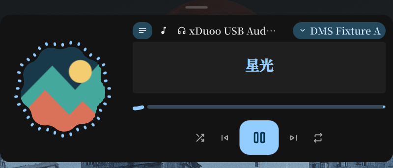
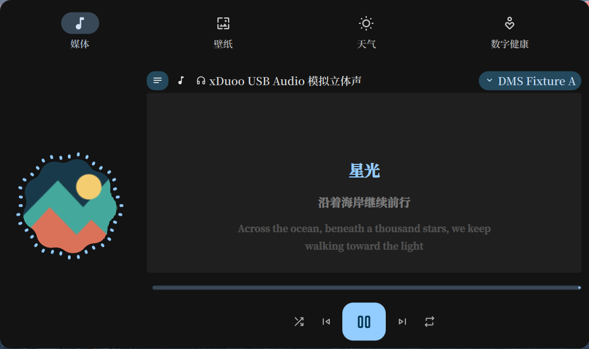

# Clavis 横向歌词灵动岛

## 使用

进入对应状态栏的灵动岛设置 → Behavior → **Compact media style** → **Clavis lyrics**。

该模式显示小封面、居中的当前歌词和五柱频谱，隐藏时间、曲名及歌手。歌词订阅独立于仪表盘媒体页的歌词开关；选择此模式即请求歌词，不改写媒体页配置。普通模式的时间和文字设置保留，切回 **Standard** 后继续使用。

播放开始时自动进入媒体仍由 **Switch to media when playback starts** 控制。也可以从主页媒体槽或紧凑态右键选择媒体。点击歌词或封面展开完整播放器，Esc 收起后回到歌词；临时打开仪表盘、通知或 OSD 不会改掉这个呈现选择。紧凑媒体区域（含时间和屏幕顶边）的中键在纯歌词与曲名 / 歌手之间切换；宽度随所选内容变化，不会展开播放器或发送播放控制。主页媒体槽的中键仍为播放 / 暂停。

紧凑条的中键选择属于当前灵动岛会话，经过展开、主页、通知和 OSD 后仍保留；不改写原来的普通模式文字设置。中键选择元数据时显示曲名 / 歌手，并保留时间入口。修改 **Compact media style** 后重新采用设置值，重载后同样从设置恢复。

展开播放器与独立仪表盘媒体页也可在卡片区域中键切换歌词 / 元数据，复用歌词按钮的开关和记忆；媒体页关闭歌词功能时不提供此手势。音量、设备面板和来源选择器打开时忽略切换，左键与滚轮继续操作原控件。紧凑条和展开播放器各自保留内容选择。

仅实现横向紧凑呈现。竖向和 dot 继续使用已有布局。

本机验收后已为 `default` 主岛启用此呈现，只写入 `islandMediaPresentation`；其余设置保持原值。启用前后的配置备份位于 `~/.local/state/dms/backups/clavis-lyrics-20261031/`。

## 外观与边界

参考 Clavis 快照 `c3ee54f147d5e85db072573857a83ca949a317a0` 的 `Modules/Keystone/LyricsContent/`，在 DMS 的主题、服务和活动结构内独立实现：

- 26px 封面、21px 五柱频谱、15px 粗体居中歌词、400ms 纵向切行。字体与颜色服从 DMS 当前主题；不引入逐字卡拉 OK 效果。
- 根据当前行测宽。为小区域使用，将 Clavis 的 350px 最小文字宽度改为 120px；最大宽度继续服从用户的媒体宽度设置和屏幕可用范围。长行单行省略，避免挤压封面和频谱。内容基准高度 42px，已有更厚的灵动岛保留其厚度。
- 加载、不可用、无结果、纯音乐和无时间戳歌词使用明确占位；同步歌词的间奏显示音符，不退回曲名或退出媒体活动。暂停保留当前内容。
- `islandMediaPresentation` 保存 `standard` / `clavis-lyrics`，新默认仍为 `standard`。`island status` 增加有效的 `mediaPresentation`，方便确认切换。

## 服务与常驻开销

复用 `LyricsService` 的唯一控制器、已有按 cue 边界唤醒的时轴及可见性订阅。不增加歌词请求进程、固定频率轮询或完整歌词列表；界面仅保存当前及上一条文字。隐藏时释放订阅。

五柱与 Caelestia 封面共享 Cava 的 45 段频谱，按频段取峰值，保留窄频信号。与 Clavis 一致，歌词频谱独立于普通可视化开关；暂停、不可见和减少动态效果时释放订阅。歌词与封面同时显示仍只有一个 Cava 进程。

歌词进入退出的实机检查暴露了 `MediaAccentService` 退出订阅时的空背景窗口，已在计算 HCT 之前增加空集合保护。

## 验证（2026-10-31）

在已有 Niri / Quickshell 会话上检查，HDMI-A-1、逻辑尺寸 2048×1152、缩放 1.25；没有启动额外 shell 或 compositor。真实播放器仅临时从 DMS 媒体列表排除，没有发送控制命令；使用人工 MPRIS 来源与本地 LRC。

| 验证 | 结果 |
| --- | --- |
| 自动检查 | `make lint-qml`、新紧凑组件及包装组件的严格定向 qmllint 无警告、修改 QML 的 qmlformat 解析、`git diff --check` 通过 |
| 现有测试 | Qt 31、lock 38 与完整 logic 套件通过 |
| 新逻辑回归 | 三项：活动主声部与换行合并、间奏和首行前不残留旧歌词、6/45 段模式的量纲转换。测试只加载 Common JS，不加载 UI 模块 |
| 回归反例 | 临时 VM 中移除歌词结束边界判断，明确保留了应已消失的旧歌词；没有改动运行中的源码 |
| 实机状态 | 23 个断言通过：媒体页歌词关闭时独立加载，长短句宽度变化，暂停/继续/seek，实际点击展开与 Esc 返回，仪表盘临时访问，右键主页/媒体切换，附属与替换 OSD 恢复，通知恢复，两种呈现热切换，来源结束回主页 |
| 尺寸 | 本机短句 221×44、长句最大 440×44、短句加附属 OSD 317×44、完整播放器 640×264；是当前配置的目标尺寸，不是固定尺寸或逐帧测量 |
| 进程与恢复 | 播放且启用可视化时一个 Cava；暂停、减少动态效果、关闭可视化时零个。恢复临时配置后字节及 JSON 均与实验前一致，清理人工来源与虚拟输入；音量和工作区恢复 |
| 最终运行日志 | 这一轮人工来源验收窗口没有 WARN / ERROR |

状态与恢复结果见 [states.json](evidence/clavis-lyrics-20261031/states.json) 和 [restoration.json](evidence/clavis-lyrics-20261031/restoration.json)。未进行长期内存/CPU 基准、逐帧动画测量、真实声源的频谱幅值对照、多屏或竖向验收；占位分支以源码检查为主，未声称真实歌词供应商的全部失败路径已覆盖。Open Orpheus 上游问题不在本次范围。

完整临时程序、原始配置备份和运行日志位于 `/tmp/dms-clavis-lyrics-20261031-jswo65k9/`，仓库不收录个人配置和完整桌面截图。

## 频谱修复（2026-10-31）

原来的歌词频谱误用了普通可视化开关与六段采样。本机关闭普通可视化时，歌词五柱因此一直静止。改为独立订阅已有 45 段频谱，统一复用 Caelestia 的数据与订阅生命周期；移除不再使用的六段量纲转换。

在现有桌面通过临时虚拟音频输出的 monitor 输入合成音，截图确认五柱实际变化。测试音不进入扬声器，不改变默认音频输出。10 个实机状态检查通过：普通可视化关闭仍采样、暂停释放、继续恢复、展开封面共享一个进程、收起保留歌词采样、减少动态效果和隐藏时释放、恢复显示后重新订阅。配置文件恢复字节一致，验收窗口日志无 WARN / ERROR。

对应 [状态记录](evidence/clavis-media-fixes-20261031/spectrum-states.json) 与 [恢复记录](evidence/clavis-media-fixes-20261031/spectrum-restoration.json)。`make lint-qml`、Qt 31、lock 38 与完整 logic 套件、`git diff --check` 通过。本节取代上面初次移植验收中“关闭可视化时零个进程”和六段转换的历史结论。未做真实音源幅值对照或长期性能基准。

## 中键切换验收（2026-10-31）

在现有桌面使用人工 MPRIS 来源、绝对指针和本地 LRC，40 项状态检查通过：紧凑条双向反复切换、顶边与时间区域中键、时间打开仪表盘并返回、主页媒体槽中键播放 / 暂停、展开播放器切换、左键播放与歌词按钮、进度 seek、音量滚轮、面板及来源选择器的交互隔离、关闭返回紧凑选择、附属 / 替换 OSD 与通知恢复、设置重新接管会话选择。普通文字设置为 `title-lyrics` 时，中键元数据仍只显示曲名和歌手，原设置值保持不变。

中键处理复用已有事件与歌词切换，不新增定时器、进程或轮询；紧凑元数据在普通可视化关闭时释放歌词频谱，返回歌词重新订阅；展开 Caelestia 与歌词仍共享一个 Cava。人工来源的调用记录仅包含验收主动触发的播放、音量与 seek，没有由内容切换产生的播放控制。

[状态记录](evidence/clavis-media-fixes-20261031/middle-states.json)、[恢复记录](evidence/clavis-media-fixes-20261031/middle-restoration.json)。最终这轮验收窗口无 WARN / ERROR；配置及缓存文件恢复字节一致，音量与工作区恢复，临时来源和虚拟输入已清理。`make lint-qml`、修改文件的 qmlformat 解析、Qt 31、lock 38 与完整 logic 套件、`git diff --check` 通过；没有增加加载 UI 模块的测试。竖向、dot、多屏、长期性能及其他播放器样式未做本轮实机验收。

独立仪表盘媒体弹窗另有 4 项实机检查通过：以元数据打开、中键进入歌词、再次中键返回、关闭后保留灵动岛选择。见 [弹窗状态](evidence/clavis-media-fixes-20261031/popup-middle-states.json) 与 [弹窗恢复记录](evidence/clavis-media-fixes-20261031/popup-middle-restoration.json)，配置、缓存与音量同样精确恢复，验收窗口无 WARN / ERROR。

## 自适应宽度修复（2026-11-01）

Clavis 紧凑歌词统一文字测量与实际渲染方式，同时取字形边界和排版占用宽度的较大值并预留边缘空间，避免字体测量偏小导致短句提前省略。歌词路径不再忽略 1px 的必要增宽。原来的 **Maximum media width** 继续作为整体硬上限，包含封面、频谱、间距和附属 OSD，并服从屏幕可用宽度；本机原配置的 560px 保持不变。

新增 **Lyrics resize threshold**（`islandLyricsWidthThreshold`），默认 24px，可设 0–96px，仅在 Clavis 歌词呈现下显示：

- 当前歌词放不下时立即增宽，目标为“所需宽度 + 阈值”，受硬上限约束。
- 新目标比当前宽度至少小一个阈值才缩窄；较小变化保留当前宽度。
- 设为 0 时按所需宽度调整。修改上限时立即遵守新边界。
- 同步歌词的间奏音符沿用上一行宽度，下一句再按上述规则调整。

这里的所需宽度包含固定部件，以及至少 120px 的歌词文字区域。例如阈值为 24px 时，本机样例所需宽度 256 → 271 → 286 → 256px，对应采用宽度 280 → 280 → 310 → 280px。

紧凑歌词的实际绘制宽度在弹簧动画和像素对齐后同样遵守上限。展开播放器保留自己的尺寸；从展开态收起及途中切换歌词时保留完整收起动画，结束后恢复紧凑上限。宽度更新由内容、设置和字体变化触发，并合并同一轮事件；只新增一个保留宽度值和一个动画状态标记，没有新增轮询、定时器或进程。

最终版本通过 `make lint-qml`、修改 QML 的 `qmlformat` 解析、`git diff --check`、Qt 31、lock 38 及完整 logic 套件。紧凑歌词 Common JS 共 7 项测试，其中 5 项覆盖新增宽度策略及其边界；新增策略和小数上限均有失败反例。

现有 Niri / Quickshell 会话的 27 项实机检查通过，覆盖中英日文与标点的完整显示、余量复用、增宽和缩窄、长句省略、间奏、降低上限、附属 OSD、零阈值、快速切行、展开 / 收起及中途重定向、普通呈现与减少动态效果。屏幕为 HDMI-A-1、逻辑尺寸 2048×1152、缩放 1.25，字体为 Noto Serif CJK SC；验收使用临时人工 MPRIS 来源及本地 LRC，没有启动额外 shell 或 compositor，也没有向真实播放器发送控制命令。

临时逐帧计数记录到 173 次原始弹簧超调回调，实际紧凑宽度越界计数为 0；另留存 20 个动画状态样本。配置、缓存恢复字节一致，音量恢复，临时来源退出。详见 [状态记录](evidence/lyrics-width-20261101/states.json)、[动画样本](evidence/lyrics-width-20261101/animation-samples.json)、[恢复结果](evidence/lyrics-width-20261101/result.json) 与 [验收说明](evidence/lyrics-width-20261101/README.md)。临时诊断代码已移除。

运行日志未出现指向本次修改文件的错误或绑定循环，但本机仍有已有插件弃用、缺失图标和初始化警告；本轮不声称全局日志无警告。以上为单屏、有限样例验收，未做长期 CPU / 内存基准或多屏、竖向及其他 compositor 验收。

最终已重载本机 `dms.service` 用户服务，新 Quickshell 实例从当前仓库的 `quickshell/` 加载，IPC 确认 Clavis 歌词呈现可用、最大宽度 560px、有效默认阈值 24px；验证期间配置字节保持一致。见 [部署记录](evidence/lyrics-width-20261101/deployment.json)。本次只有 QML / JS 改动，无需替换 Go 二进制。
