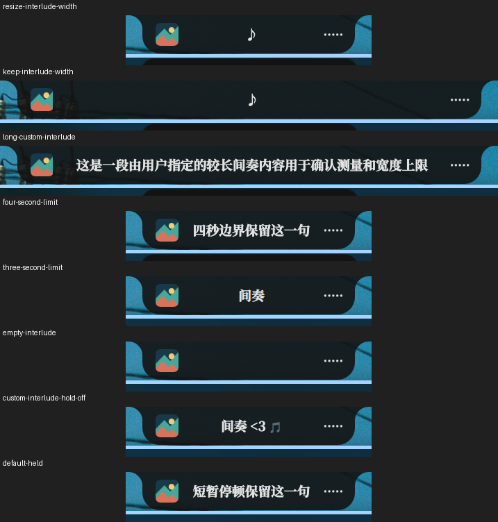

# Lyric display settings — 2026-11-01

Media controls are grouped in `IslandMediaCard`, shared by standalone and hosted islands. New per-instance settings control short-gap holding, its duration, interlude text and retained interlude width. Existing media presentation, auto-switch, clock, text mode, maximum width and resize threshold remain available. Dot has no media card or searchable media settings.

Defaults preserve the previous Clavis appearance: hold known interior gaps up to four seconds, display `♪` outside them, and retain width. Holding can be disabled; duration accepts 1–10 seconds. Empty interlude text hides the text. Input and runtime normalization cap text at 128 UTF-16 units without leaving a trailing high surrogate; rendering remains plain text. A longer custom interlude can increase width while still respecting the existing cap. Word timing and controller focus remain unchanged.

## Validation

- Focused Common/Services and settings logic: 40 tests passed. Three new helper behavior tests fail against the previous implementation (13 passes / 3 expected failures); see `baseline-result.txt`. The new persistence/reset test also failed against the previous defaults before implementation.
- `make test-qml`: Qt 31, lock 38 and the complete logic suite passed.
- `make lint-qml`, parsing all changed QML with qmlformat, and `git diff --check` passed.
- The official settings-index extractor produced 934 entries; repeated generation was stable. No translation catalog was edited.
- Independent final source review found no remaining blocking issue.

## Existing desktop

The current Niri / Quickshell desktop was reloaded from this checkout. A temporary synthetic MPRIS source and local LRC exercised eight states: default holding, custom interlude with holding off, empty text, a four-second gap with three-second and four-second thresholds, longer custom text, retained width and immediate resizing when retention is disabled. All eight cropped screenshots were inspected; see `contact-sheet.png`, `live-states.json` and `live-result.json`. The observed width changed from 535px to 245px when retention was disabled; the custom text remained below the configured 560px cap.

Settings search navigated to the new interlude field. The user resumed desktop interaction during the subsequent keyboard check, so keyboard automation stopped. User changes to interlude text and width preference were preserved when removing the temporary source and settings overrides. Input completion and the reset button are not claimed as fully verified desktop interactions; their binding and persistence paths were reviewed and persistence/reset logic was covered by the Common tests. Real players received no controls. No additional shell, compositor or display server was started. Full desktop captures were removed; committed pictures contain only the synthetic island.

There are no new runtime timers, processes, polling loops or persistent indexes. Settings use existing writes and reactive bindings. These checks do not claim long-term resource measurements, multi-screen or other compositor acceptance.

## Build and startup

Implementation commit: `a6b1c9c86b76d6cd80773b006dde59b2e01568e6`. `make build` succeeded with clean Git metadata and version `2.0.0+git5363.a6b1c9c8`. The user binary was replaced atomically and `dms.service` restarted at 01:30:38 Asia/Shanghai. The installed and built hashes match, the service is active, and its sole Quickshell process loads this checkout. Settings bytes remained unchanged since the deployment backup, including the user's concurrent preferences. No changed-component warnings or binding loops were found in the post-restart journal. See `build.log` and `deployment.json`.

