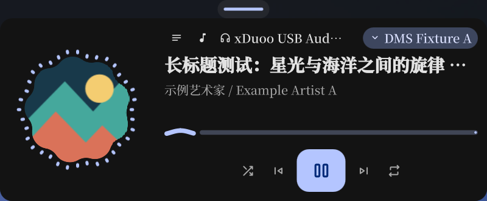

# 灵动岛的内容选择与渐进展开

## 问题与修复

媒体紧凑态原来的时间按钮调用 `requestActivity("home", false, false)`，把“查看时间”当作了选择常驻主页，并清掉 `mediaPreferred`。主页的媒体按钮则只打开完整播放器，不选择媒体紧凑态。两条路径组合后，即使播放器可以再次打开，收起仍然落回主页，歌词和封面无法通过这个入口恢复。自动切换只在媒体开始可用时触发，不会在持续播放期间纠正这个选择。

现在将常驻内容、展开页面和临时提示分别处理。时间按钮展开仪表盘，保留常驻媒体选择；主页的小封面选择媒体紧凑态。用户可以在播放持续进行时反复查看时间、收起和回到媒体，无须重启或重新开始播放。

## 交互约定

| 当前内容与操作 | 结果 | 收起后的内容 |
| --- | --- | --- |
| 主页，点击小封面 | 岛横向增长，显示封面、曲名或歌词，保持紧凑高度 | 媒体紧凑态 |
| 媒体紧凑态，点击封面或曲目区域 | 展开完整播放器 | 媒体紧凑态 |
| 媒体紧凑态，点击时间 | 展开仪表盘 | 媒体紧凑态 |
| 紧凑态，右键切换主页/媒体 | 显式选择常驻内容，保留现有快捷操作 | 本次选择 |
| 通过仪表盘卡片、快捷键或 IPC 打开页面 | 临时展开该页，不改常驻选择 | 原常驻内容 |
| Esc、外部关闭请求或面板收起 | 收起当前页 | 有效的常驻内容；媒体已结束则回主页 |
| 播放开始，启用自动切换 | 紧凑主页可切为媒体；已有展开页继续显示，记录关闭后回到媒体 | 媒体紧凑态 |
| 通知或 OSD 出现 | 临时显示提示；附属 OSD 沿用现有布局 | 结束后恢复；被关键通知打断的展开页保持展开恢复 |

主页的小封面仍使用用户配置的媒体槽位及顺序，不强制插入被关闭的槽位。若主动隐藏该槽位，紧凑态右键仍可切换媒体。无媒体时该槽位继续提供原来的搜索入口，中键播放/暂停行为保持原样。

“主页小封面 → 媒体紧凑条 → 完整播放器”是三个按需增长的层级。媒体条继续按内容测量宽度并受现有最大宽度设置限制；时间、文字模式、OSD 样式及播放器设置保持独立。没有新增常驻工具栏或额外固定占位。

混合悬停模式下，点击选择紧凑内容后，保持紧凑直到指针离开；明确收起面板后也不会在原位置立即重新展开。离开后再进入，继续按原来的悬停延迟展开；由悬停打开的页面在离开后收起。

## 状态边界

- `mediaPreferred` 只代表收起后选择媒体；查看时间或临时展开页面不会清除它。显式选择紧凑主页可以覆盖它，不使用轮询或元数据变化反复抢回媒体。
- 自动播放切换可以更新收起目标，但不打断已经打开或正在加载的页面，也不清除目标页的 pending 请求。
- 通知保存被打断的页面及展开状态。播放在通知期间开始时，只修正适用的紧凑返回目标，保留展开仪表盘的恢复路径。
- 暂停的来源继续可用。来源结束或消失后沿用原有 1800ms 宽限，收起时回到主页；曲目间短暂失联沿用现有恢复机制。
- `Common/IslandInteraction.js` 集中处理紧凑入口、偏好和自动切换策略；没有把通知计时器或页面加载生命周期搬进新的状态机。
- `island status` 增加 `idleActivity`、`targetWidth` 和 `targetHeight`，便于核对收起目标与内容尺寸。宽高是动画目标值，不是动画中的逐帧实测尺寸。

## 验证记录（2026-10-31）

在现有 Quickshell 会话与 Niri、HDMI-A-1、1.25 倍缩放上验收，没有启动额外 shell 或 compositor。

| 验证 | 结果 |
| --- | --- |
| 六项纯逻辑回归 | 连续查看时间并返回、主页媒体入口、临时展开不改偏好、展开期间播放开始、通知/OSD 返回策略、媒体结束时回落全部通过；测试仅加载 Common JS |
| 旧行为反例 | 在临时副本中把时间入口恢复为紧凑主页请求，连续时间访问用例明确失败；未替换运行中的源码 |
| 实际指针与键盘 | 临时绝对指针和虚拟键盘向既有桌面发送输入；连续三次点击时间后 Esc 均回到媒体；右键选主页、小封面恢复媒体、点击主体展开播放器、收起、离开再进入悬停展开、离开收起全部通过，共 15 个状态断言 |
| 人工来源 | 两次点击时间并返回仍保留封面与本地 LRC 歌词；播放在展开仪表盘期间开始，页面不切换，Esc 后回媒体；通知自动结束后回媒体；查看时间期间来源结束，仪表盘保留，关闭后回主页，共 17 个状态断言 |
| 配置与进程 | 真实来源点击阶段未改配置；人工来源阶段按实验开始时快照恢复配置，JSON 内容和文件字节均一致。人工播放器和虚拟输入设备退出，无遗留验收进程 |
| 自动检查 | Qt 31 项、lock 38 项及 logic 套件通过；`make lint-qml`、修改 QML 的 `qmlformat` 解析和 `git diff --check` 通过 |

本次配置记录的目标尺寸为：主页 192×44，带歌词的媒体紧凑条 440×44，完整播放器 640×264；它们是当前主题、内容及设置下的记录，不是写入代码的固定尺寸。截图与状态只归档人工内容，见 [验收证据](evidence/island-interaction-20261031/)。

资源审查：新增策略只在用户请求或已有媒体状态事件中执行，没有新增 Timer、轮询、常驻进程或无界集合；主页的小封面替换原来的频谱视图，不再为该入口持有可视化订阅。本轮未做性能 A/B 或长期内存测量。

纯策略覆盖通知与 OSD 的返回分支；本轮实机验证了通知恢复，没有重新验证实际音量/亮度 OSD、多屏、竖栏、自由拖动和 dot 的全部交互。Open Orpheus 的上游兼容问题按本轮范围未作修改。

完整临时程序、配置快照和运行日志保留于 `/tmp/dms-island-interaction-20261031-4w5j8ejh/`；仓库不收录用户配置、真实媒体截图或完整桌面截图。
